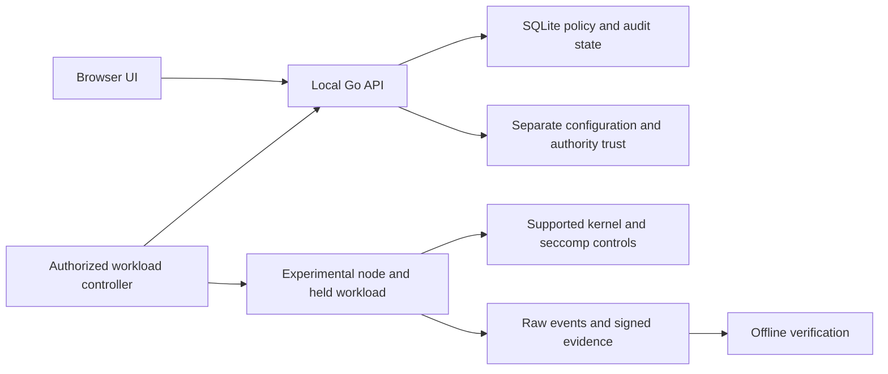

# Architecture and trust boundaries

The source includes a local control application and experimental enforcement components.

## Local control application

`cmd/community` opens protected local configuration and the policy store.
`internal/localconfig` signs configuration versions and checks the independent revision anchor.
`internal/control` implements local users, roles, sessions, policy versions, approval requests and evidence access.
`web/src` contains the React interface. Local authentication needs no external fleet service. OIDC is optional.

State and trust use separate durable Docker volumes. A workload must not mount either volume.
Backups can contain private keys. Their custody is outside the workload boundary.
The source includes backup and restore code; the preview does not claim fresh disaster-recovery acceptance.

## Enforcement and evidence

`cmd/poc` supplies the limited inspection entrypoint and verifier.
`internal/qualification`, lifecycle, backend and resource packages contain the evolving full-policy implementation.
BPF programs observe or enforce selected kernel operations. The scalar seccomp filter and exec broker cover other boundaries.
A hook name alone does not prove enforcement. Admission needs complete behavior evidence for the exact policy, kernel and artifact set.

Raw event streams, sequence counters, loss counters and terminal state determine evidence completeness.
Node and authority signatures have separate roles. The verifier checks exact binding, raw data, counter continuity and loss.
The source preview does not substitute the limited inspection path for the complete full-policy contracts.

## Development boundary

The two exported web QA files use schema fixtures and owned browser mock responses.
The private browser fixture, private keys, fleet configuration, native logs and private Git history are excluded.
Cloud development can build and inspect the application. Kernel behavior tests require a separate marked disposable Linux VM.
